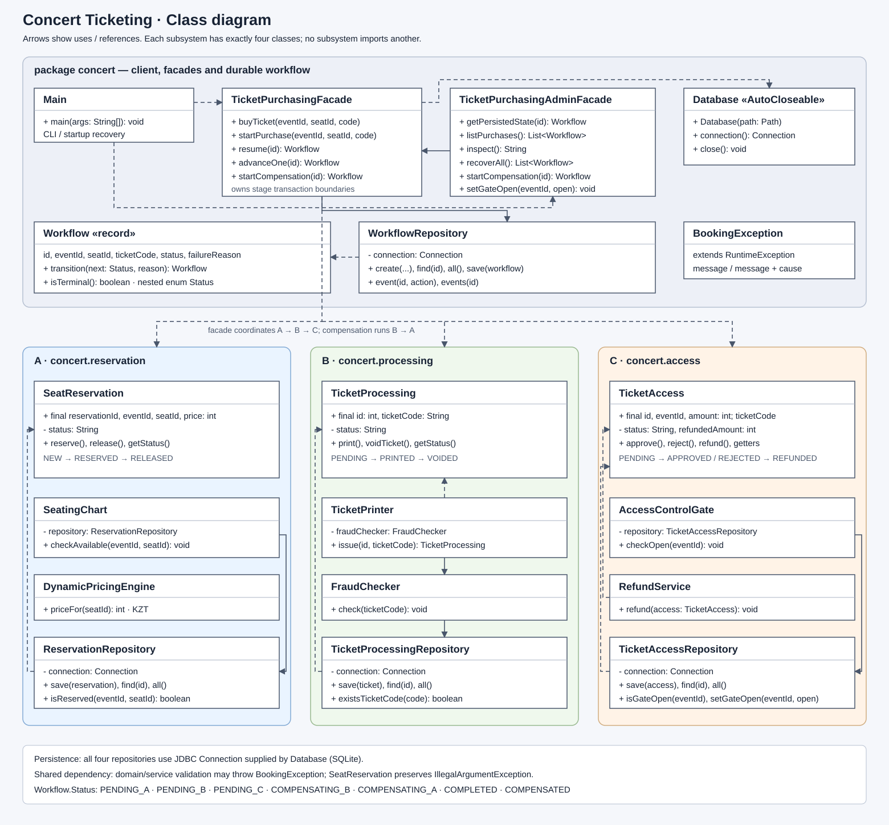

# Concert Ticketing — Assignment 4, Facade

Консольная покупка концертного билета: **A → B → C**, SQLite, восстановление после перезапуска и компенсация выполненных шагов в обратном порядке. Нужны **JDK 25** и Maven; `JAVA_HOME` должен указывать на JDK 25.

## Сборка и запуск

Из папки проекта в PowerShell:

```powershell
.\run.ps1
```

Скрипт собирает проект и запускает JAR через `JAVA_HOME`. В этой Windows команда `java` из PATH может указывать на старую Oracle Java, поэтому ручной запуск использует явный путь:

```powershell
mvn clean verify
& "$env:JAVA_HOME\bin\java.exe" --enable-native-access=ALL-UNNAMED -jar target/concert-ticketing.jar
```

Путь к другой базе и отключение автоматического восстановления:

```powershell
& "$env:JAVA_HOME\bin\java.exe" --enable-native-access=ALL-UNNAMED -jar target/concert-ticketing.jar demo.db --no-recover
```

По умолчанию используется `concert.db`. Без `--no-recover` при запуске продолжаются все незавершённые покупки. После закрытия программы сбросить **только демонстрационную базу** можно так:

```powershell
Remove-Item -LiteralPath .\concert.db -ErrorAction SilentlyContinue
```

## Меню

| Пункт | Действие |
|---|---|
| 1 | Купить: event ID, seat ID, ticket code |
| 2 | Показать workflow, журнал шагов и записи A/B/C |
| 3 | Открыть/закрыть вход события: event ID, затем 1/0 |
| 4 | Восстановить все незавершённые покупки |
| 5 | Компенсировать незавершённую покупку по workflow ID |
| 6 | Начать покупку и остановиться после A |
| 7 | Выполнить один следующий шаг по workflow ID |
| 0 | Выйти |

Событие — положительный ID, места — 1–100. Места 1–10 стоят 15 000 KZT, 11–100 — 12 000 KZT. Вход открыт по умолчанию. Уже сохранённый ticket code повторно использовать нельзя, даже после аннулирования билета.

## Устройство проекта



| Подсистема | Ровно четыре класса | Ответственность |
|---|---|---|
| A: `concert.reservation` | `SeatReservation`, `SeatingChart`, `DynamicPricingEngine`, `ReservationRepository` | Проверка места, цена, резервирование и освобождение |
| B: `concert.processing` | `TicketProcessing`, `FraudChecker`, `TicketPrinter`, `TicketProcessingRepository` | Проверка повторного кода, выпуск и аннулирование билета |
| C: `concert.access` | `TicketAccess`, `AccessControlGate`, `RefundService`, `TicketAccessRepository` | Разрешение входа или отказ и локальный возврат |

`TicketPurchasingFacade` координирует покупку и компенсацию. `TicketPurchasingAdminFacade` предоставляет просмотр, восстановление, настройку входа и ручную компенсацию. `Main` вызывает эти два фасада. Репозитории выполняют SQL; общая `Database` создаёт схему. Подсистемы не импортируют друг друга и не знают о workflow.

Каждый `advanceOne` выполняет отдельную транзакцию: действие подсистемы, запись журнала и следующий статус фиксируются вместе. Ошибка SQL откатывает текущий шаг; последний зафиксированный статус остаётся для следующей попытки. База запрещает два активных резерва одного места события и повторный код билета.

## Состояния и компенсация

Успех:

```text
PENDING_A → PENDING_B → PENDING_C → COMPLETED
```

Отказ B освобождает A:

```text
PENDING_B → COMPENSATING_A → COMPENSATED
```

Отказ C записывает возврат, затем аннулирует B и освобождает A:

```text
PENDING_C → COMPENSATING_B → COMPENSATING_A → COMPENSATED
```

Отказ A завершает workflow как `COMPENSATED` без создания билета. Ручная компенсация отменяет только незавершённую покупку; `COMPLETED` отклоняется. Повторный вызов восстановления или компенсации терминального workflow не повторяет действия.

Состояния сущностей: A — `NEW → RESERVED → RELEASED`; B — `PENDING → PRINTED → VOIDED`; C — `PENDING → APPROVED` либо `PENDING → REJECTED → REFUNDED`. Недопустимые переходы отклоняются.

`RefundService` записывает **полную сумму локального кредита в KZT** в `ticket_access.refunded_amount`. Это учебная запись SQLite: платёжного шлюза, списания и банковского перевода в проекте нет. Закрытый вход сохраняет C как `REFUNDED`; ручная отмена до C только компенсирует уже выполненные A/B.

## Сценарии для демонстрации

Сначала соберите JAR. Команды ниже подают меню построчно. Каждый сценарий использует отдельную новую базу; перед повторением удалите соответствующий файл после закрытия программы.

```powershell
$ticketingJava = Join-Path $env:JAVA_HOME 'bin\java.exe'

# Успех: A_RESERVED, B_PRINTED, C_APPROVED; COMPLETED.
@('1','100','15','OK-1','2','0') | & $ticketingJava --enable-native-access=ALL-UNNAMED -jar target/concert-ticketing.jar success.db

# Отказ B: вторая покупка с тем же кодом; её резерв станет RELEASED.
@('1','100','15','DUP-1','1','100','16','DUP-1','2','0') | & $ticketingJava --enable-native-access=ALL-UNNAMED -jar target/concert-ticketing.jar refusal-b.db

# Отказ C: закрыть вход; REFUNDED, VOIDED, RELEASED; COMPENSATED.
@('3','200','0','1','200','1','CLOSED-1','2','0') | & $ticketingJava --enable-native-access=ALL-UNNAMED -jar target/concert-ticketing.jar refusal-c.db

# Перезапуск: первая команда сохраняет PENDING_B, вторая автоматически завершает B/C.
@('6','300','15','RESTART-1','0') | & $ticketingJava --enable-native-access=ALL-UNNAMED -jar target/concert-ticketing.jar restart.db --no-recover
@('2','0') | & $ticketingJava --enable-native-access=ALL-UNNAMED -jar target/concert-ticketing.jar restart.db

# Ручная компенсация: ID=1 в новой базе; --no-recover сохраняет паузу до пункта 5.
@('6','400','15','MANUAL-1','0') | & $ticketingJava --enable-native-access=ALL-UNNAMED -jar target/concert-ticketing.jar manual.db --no-recover
@('5','1','2','0') | & $ticketingJava --enable-native-access=ALL-UNNAMED -jar target/concert-ticketing.jar manual.db --no-recover
```

Для пошагового показа: запустите новую базу с `--no-recover`, выберите 6, затем 7 и ID покупки. После первого 7 статус — `PENDING_C`, после второго — `COMPLETED`. Пункт 2 показывает сохранённые записи и порядок событий.

## Независимое использование подсистем

Эти фрагменты выполняются внутри метода с `throws SQLException` и открытой `Database db`; нужны импорты классов соответствующего пакета. Никакой фасад для них не требуется:

```java
// A: самостоятельно зарезервировать место.
var reservations = new ReservationRepository(db.connection());
new SeatingChart(reservations).checkAvailable(100, 15);
var reservation = new SeatReservation(1, 100, 15, new DynamicPricingEngine().priceFor(15));
reservation.reserve();
reservations.save(reservation);

// B: самостоятельно выпустить билет.
var tickets = new TicketProcessingRepository(db.connection());
var ticket = new TicketPrinter(new FraudChecker(tickets)).issue(2, "STANDALONE-B");
tickets.save(ticket);

// C: самостоятельно разрешить вход.
var access = new TicketAccessRepository(db.connection());
new AccessControlGate(access).checkOpen(100);
var entry = new TicketAccess(3, "STANDALONE-C", 100, 12000);
entry.approve();
access.save(entry);
```

Примеры рассчитаны на новую базу. Проверки независимости находятся также в тестах каждого пакета: реальные SQLite-файлы через `@TempDir`, без запуска остальных подсистем.

## Principle of Least Knowledge: до и после

До фасада клиент самостоятельно связывал бы A, B и C и обрабатывал бы их отказ. Например, доступный публичный API позволяет написать такой фрагмент, но клиенту приходится знать репозитории, сервисы и сущности:

```java
var reservations = new ReservationRepository(db.connection());
new SeatingChart(reservations).checkAvailable(eventId, seatId);
var r = new SeatReservation(id, eventId, seatId, new DynamicPricingEngine().priceFor(seatId));
r.reserve();
reservations.save(r);
var tickets = new TicketProcessingRepository(db.connection());
var t = new TicketPrinter(new FraudChecker(tickets)).issue(id, code);
tickets.save(t);
var access = new TicketAccessRepository(db.connection());
new AccessControlGate(access).checkOpen(eventId);
var c = new TicketAccess(id, code, eventId, r.price);
c.approve();
access.save(c);
// Здесь клиенту ещё нужны сохранение workflow и компенсация при отказах.
```

После фасада клиент выражает одну операцию:

```java
var purchasing = new TicketPurchasingFacade(db);
Workflow result = purchasing.buyTicket(eventId, seatId, code);
```

Это уменьшает знание клиента о внутреннем устройстве: `Main` не получает репозитории через цепочки getter-вызовов и не меняет сущности A/B/C. Вспомогательные классы остаются доступны для независимого использования; фасад не превращён в единственный разрешённый вход.

## Facade и Adapter

Facade предоставляет простой вход в несколько согласованных операций. В этом проекте запрос «купить билет» включает проверку места, расчёт цены, резерв, проверку кода, выпуск билета и решение о входе. Клиент вызывает `buyTicket`, а порядок A → B → C, сохранение прогресса и компенсация находятся в `TicketPurchasingFacade`. Административные задачи вынесены во второй фасад, чтобы просмотр и восстановление имели ясный отдельный API.

Adapter нужен, когда уже существующий компонент имеет неподходящий интерфейс. Например, сторонний принтер мог бы принимать `printPdf(byte[])`, а наша система ожидает выпуск билета по ID и коду. Адаптер переводил бы один контракт в другой, преобразовывал данные и возвращал результат в форме, понятной вызывающему коду. Здесь такого стороннего несовместимого API нет, поэтому отдельный Adapter не добавлен.

Оба паттерна могут оборачивать другие объекты, но решают разные задачи. Facade уменьшает количество деталей, которые должен знать клиент; Adapter обеспечивает совместимость интерфейсов. Один фасад может внутри использовать несколько адаптеров, если позже появятся внешний принтер, платёжный сервис или система контроля доступа. Это не изменит смысл клиентского `buyTicket`.

Важное следствие для этого задания: само наличие фасада не обеспечивает сохранность данных или компенсацию. Эти свойства реализованы явными статусами workflow, транзакциями SQLite и обратными действиями `voidTicket` и `release`. Репозитории сохраняют свою узкую ответственность, а сущности проверяют переходы состояний. Поэтому шаблон здесь объясняет организацию публичного API, а надёжность можно отдельно проверить тестами и перезапуском процесса.

## Проверка

```powershell
mvn clean verify
```

JUnit 5 проверяет жизненные циклы, недопустимые данные, реальные SQL-ограничения, успех A/B/C, отказы B/C, компенсацию, повторные вызовы и восстановление из файла. Тесты F.I.R.S.T.: быстрые локальные вызовы; независимые временные базы; повторяемые фиксированные входы; автоматические assertions; тесты добавлены вместе с реализацией. Проверка JaCoCo требует минимум 80% покрытия строк для каждого из трёх пакетов и каждого фасада.

Отчёты после сборки: `target/surefire-reports/` и `target/site/jacoco/index.html`. Зафиксированные результаты запусков и точные показатели покрытия см. в [VERIFICATION.md](VERIFICATION.md). Лог сборки не заменяет отдельную демонстрацию восстановления между процессами.

## Сдача

Сохранены исходные Maven-настройки как основа проекта и исходный `SeatReservationTest` с добавленным импортом; `SeatReservation` перенесён из соседнего исходного проекта и дополнен валидацией. Репозиторий проекта: [https://github.com/Temirlan222/ConcertTicketing](https://github.com/Temirlan222/ConcertTicketing). Исходники, тесты и документация публикуются вместе реальными коммитами текущей датой; история предыдущих этапов не воссоздавалась. Для сдачи отправьте ссылку на репозиторий в Moodle. Базы `.db` и `target/` в репозиторий не нужны.
